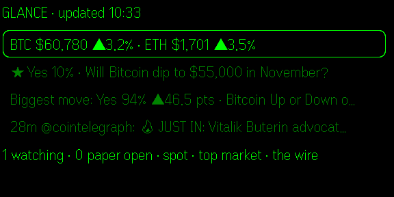
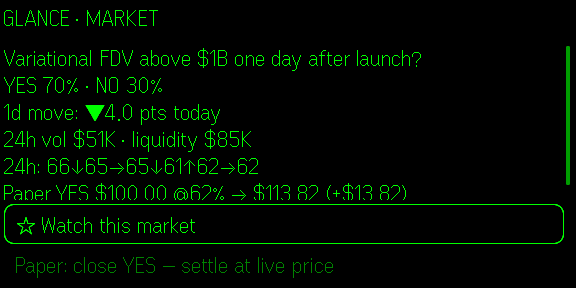
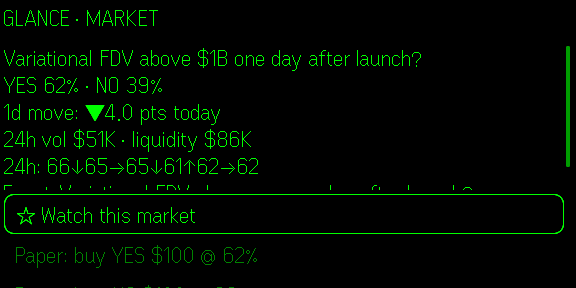
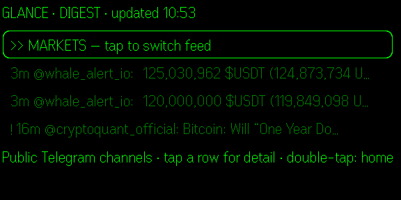
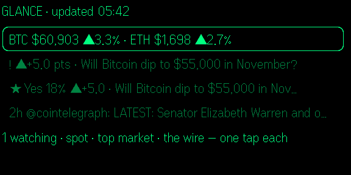
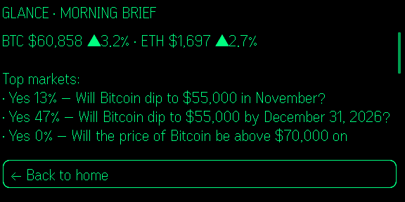

# Glance — Polymarket odds + Telegram crypto digest on Even Realities G2

**Glance** puts the things a crypto holder checks fifty times a day —
BTC/ETH spot, live prediction-market odds and the whale/news wire — into a
single glance on Even Realities G2 glasses. The home screen *is* the
answer: spot prices, your top watched market, the day's biggest mover,
the latest headline. One tap goes deeper; one more tap composes a
shareable brief — or opens a paper position that marks to market on the
same screen. If a market you watch moves 3+ points, the glasses tell you.
No phone out of the pocket, no doom-scrolling.

Built for the Even Realities **"Heads Up" Hackathon** (DoraHacks), entering
two tracks with one genuinely connected app:

- **Track 02 — Crypto & DeFi (primary):** live Polymarket odds for the
  top-15 headline crypto markets, price-first, with 24h price history, a
  persistent watchlist with move alerts, and persistent paper positions
  marked to market.
- **Track 01 — Messaging & News (secondary):** a merged, timestamped digest
  of five public Telegram crypto channels (whale alerts + headlines), with
  market-moving keyword flags (BTC / ETH / ETF) — the same glance, the
  same tap flow.








## Quick start (judges: three one-command steps)

Everything below runs locally with **no API keys and no accounts**. The
glasses app talks to a tiny zero-dependency backend proxy; the proxy is the
only thing that touches the public internet APIs.

```bash
# 1) Install the app dependencies
cd app && npm install

# 2) Start the data proxy (terminal A) — Polymarket + Telegram, server-side
npm run proxy            # → http://localhost:8787  (GET /health → {"ok":true})

# 3) Start the app (terminal B)
npm run dev              # → http://localhost:5173
```

Then run it:

- **Simulator (free, no glasses needed):** `npm run simulate`
- **Real G2 glasses:** `npx evenhub qr --url http://<your-lan-ip>:5173` and
  scan with the Even Hub companion app.
- **Package a build:** `npm run pack` → `out.ehpk`. A ready-made package
  of the current build ships in this repo as **`app/glance.ehpk`** — the
  installable build, no toolchain needed.

The app renders live data within seconds. If the proxy is not running, the
markets feed tries Polymarket Gamma directly (see *Data path* below) and the
digest shows the built-in offline state with a tap-to-retry row — never a
blank screen.

## What it does

- **Home glance** — the app's promise in one screen, shown at startup:
  BTC + ETH spot with 24h change, any watch alert, the top watched (or
  top) market with its Yes %, a **biggest-mover row** (the fetched market
  with the largest 24h move, when it isn't already the top row), and the
  single latest headline — each row one tap from its detail. The footer
  counts what you hold: `1 watching · 1 paper open`.
- **Markets list** — the **top 15** crypto events on Polymarket right
  now, one headline market per event (its most-traded market — no
  sub-market floods), each row price-first:
  `Yes 13% · Will Bitcoin dip to $55,000 in November?`
- **Market detail** — YES/NO prices, 1-day price move, 24h volume,
  liquidity — plus the market's **24h price trend** with a direction
  arrow per hourly step (`24h: 66↓65→65↓61↑62→62`, samples from the
  Polymarket CLOB history endpoint; ↑/↓/→ all verified against the G2
  font in the framebuffer).
- **Watchlist + alerts** — one tap on a market detail pins it to the top
  of the list with a ★; the set persists across restarts (localStorage),
  together with the last-seen price of each watched market. Between
  refreshes, a move of **≥3 points** flags the row (`▲+5.0`), adds an
  alert line to the detail, and puts an alert row on the home screen.
- **Paper positions** — one tap on a market detail opens a $100 paper
  position on YES or NO at the live price; the detail then carries its
  live mark (`Paper YES $100.00 @62% → $113.82 (+$13.82)`) and a one-tap
  close that settles at the live price. Positions persist across
  restarts (localStorage), one per market. Paper only — no funds, no
  keys, nothing leaves the device.
- **Digest list** — the latest posts from five public Telegram channels
  (`whale_alert_io`, `cointelegraph`, `WatcherGuru`, `unfolded`,
  `cryptoquant_official`), merged newest-first, deduped, each row tagged
  with age + source. Posts mentioning **BTC, ETH or ETF** are flagged
  with a `!` marker in the list (and on the home headline), and the post
  detail names what it matched (`Mentions: BTC · ETF`) — so a glance at
  the wire already tells you which posts can move your markets.
- **Brief** — one tap rewrites any market or post as a single shareable
  line, composed on-device from the live numbers. No LLM round-trip: the
  draft is already written when you look.
- **Morning brief** — one tap from home composes the whole morning on one
  screen: the BTC/ETH line, the top-3 markets with odds, the top-2
  headlines — ready to share.
- **Auto-refresh** — all feeds refresh every 60 s; the header shows
  `updated HH:MM`, and `· STALE` if a refresh fails while old data stays up.
- **Navigation** — tap to open, double-tap steps back (system exit dialog
  on the home page), scroll to browse. Designed for the 576×288 monochrome
  canvas: big type, one fact per row, nothing decorative.

## Architecture

```
┌──────────────┐   whitelisted origin    ┌────────────────────┐
│  G2 WebView  │ ───────────────────────▶│  Glance proxy      │
│  app (Vite + │   GET /api/markets      │  server/proxy.mjs  │
│  TypeScript, │   GET /api/digest       │  zero-dependency   │
│  Even Hub SDK│   GET /api/spot         │  Node (stdlib) +   │
│              │◀─────────────────────── │  SWR response cache│
└──────────────┘   GET /api/history      └──────┬─────────────┘
  slim JSON                                     │ server-side fetch
                          ┌─────────────┬───────┴───────┬─────────────┐
                          ▼             ▼               ▼             ▼
                   Polymarket      Polymarket      CoinGecko    Telegram
                   Gamma API       CLOB history    spot prices  public previews
                   (crypto events) (24h trend)     (BTC/ETH)    (t.me/s HTML)
```

**Why a proxy at all?** The G2 WebView may only call origins whitelisted in
`app.json`, and the upstream sources are awkward from a WebView: Telegram
digests exist only as HTML pages that need parsing, and no source is
shaped for a 576×288 glance. The proxy fetches server-side, applies the
honest headline-market selection and the text cleanup the G2 font needs,
and serves slim JSON. It has **zero npm dependencies** — Node's standard
library plus global `fetch` — so `npm run proxy` is the whole deployment.
A stale-while-revalidate cache (plus startup pre-warming) keeps every
glance instant even though a cold upstream fetch takes seconds.

**Data path & fallback.** Normal operation is proxy-first. If the proxy is
unreachable, the markets feed falls back to fetching the Polymarket Gamma
API **directly** from the app (that origin is whitelisted in `app.json`
too) and applies the same headline selection on-device; if the WebView's
CORS policy refuses that response, the app keeps its STALE/offline state
instead of showing invented data. The Telegram digest always needs the
proxy (it parses HTML) and degrades to the offline/retry state without it.
A hosted proxy build can be selected at build time with
`VITE_PROXY_BASE_URL=<origin> npm run build`.

**Public tunnel (demo convenience) — attempted, environment-blocked.** We
tried to also expose the local proxy through a Cloudflare quick tunnel
(`cloudflared`, installed locally) so the app could be pointed at a public
origin without any deployment. From our build VM this does not work: the
VM's egress intercepts direct TLS, and even through the egress proxy the
quick-tunnel registration request (`POST https://api.trycloudflare.com/tunnel`)
never answers — reproduced with both `cloudflared` and plain `curl`, while
ordinary GETs through the same path succeed (details in `BUILDLOG.md`,
Day 3). On an unrestricted network the same one-liner —
`cloudflared tunnel --url http://localhost:8787` — plus a
`VITE_PROXY_BASE_URL=<tunnel-origin>` build and the tunnel origin in the
`app.json` whitelist is all it takes. The localhost setup above is the
primary, always-reproducible path, and it is what the demo video uses.

## Data sources & safety

- **Polymarket Gamma public API** (`gamma-api.polymarket.com`) — public,
  read-only, no API key. Glance only *displays* odds; it places no trades
  and touches no funds.
- **Polymarket CLOB public API** (`clob.polymarket.com`) — the
  `prices-history` endpoint behind the 24h trend; public, read-only.
- **CoinGecko public API** (`api.coingecko.com`) — BTC/ETH spot + 24h
  change, no key (Kraken's public ticker is the proxy's fallback;
  Binance's public API is geo-blocked from our build machine and unused).
- **Telegram public channel previews** (`t.me/s/<channel>`) — public web
  pages, no account, no Bot API token. Only channels with a genuinely
  public preview are used (verified: `whale_alert_io`, `cointelegraph`,
  `WatcherGuru`, `unfolded`, `cryptoquant_official`; channels without a
  public preview, e.g. CoinDesk's or WuBlockchain's, are excluded rather
  than scraped some other way).
- **No keys, no accounts, no user funds, no server-side writes**
  anywhere in the system. The watchlist and the paper positions live in
  the app's local storage on the device; paper trading is simulated
  on-device and never touches a real order book.

## An honest note on voice

The app is **tap-first by design**, and we verified why rather than
assuming: the Even Hub SDK exposes **raw PCM audio only — there is no
speech-to-text in the SDK** — and in the Even Hub simulator the microphone
cannot be opened at all (`audioControl(true)` returns `false`, zero audio
frames arrive, and the simulator's automation API has no audio injection).
Voice commands would need an external ASR service behind the proxy and
real hardware to test; rather than fake a voice demo, Glance makes the
tap flows fast enough that the answer is one or two taps away. The probe
evidence is in `BUILDLOG.md` (Day 2) with a screenshot.

## What existed before Nov 23 (event start)

- The **official `evenhub-templates/minimal` template** (Even Realities,
  public) — the scaffold this app started from on Nov 26.
- The **public APIs** above (Polymarket Gamma, Telegram public previews).
- General-purpose tooling (Node, Vite, TypeScript, the Even Hub CLI and
  simulator).

Everything else — the proxy, the feed selection and cleanup logic, the
glasses UI (home / list / detail / brief / morning brief), the watchlist
and its move alerts, the brief composers, the offline states, this README
and the build log — was designed and built during the hackathon window
(Nov 26–29). The full story, including the traps we hit (63-byte list-item
cap, cold-start-only page creation, a dedupe regex that ate prose, glyphs
the G2 font silently drops), is in [`BUILDLOG.md`](BUILDLOG.md).

## Feature list, mapped to the judging rubric

| Rubric line | How Glance answers it |
| --- | --- |
| Usefulness on G2 (25%) | The highest-frequency crypto checks — spot, odds, whale/news wire — in one home glance, on the device you are already wearing; watch alerts mean the glasses speak first when a market you follow moves ≥3 pts. |
| Read-and-write (20%) | Read: spot, both feeds, 24h trends, live. Write/act in seconds: one tap pins a market to a persistent watchlist; one tap opens/closes a persistent paper position marked to market; one tap composes a shareable one-line brief; one tap composes the full morning brief (spot + top markets + the wire). |
| Technical execution (20%) | End-to-end on **real accounts-free live data**, not mocks: real Polymarket odds + CLOB price history, real CoinGecko spot, real Telegram posts from five channels, verified in the simulator at every step (see `app/docs/day2-*.png`, `app/docs/day4-*.png`, `app/docs/day5-*.png` and `BUILDLOG.md`). Zero-dependency proxy with a stale-while-revalidate cache; offline/STALE states tested by killing the proxy mid-flight; the watch-alert and paper-P&L paths exercised end-to-end against a local test double (documented in the log). Even Hub SDK 0.0.16, adopted only after a full scratch re-verification. The installable `app/glance.ehpk` ships in the repo. |
| UX for display/voice (15%) | Designed for 576×288 monochrome: price-first rows within the firmware's 63-byte cap, one fact per row, double-tap back, header clock + STALE honesty; every glyph used was verified against the G2 font (block-char sparklines were prototyped, found missing from the font, and replaced with a textual trend). Voice: honestly scoped out (see the voice note) instead of faked. |
| Business potential + safety (20%) | A plausible companion for any odds/news source (the feed layer is source-agnostic); read-only by construction — no keys, no custody, no trading, no user funds at risk. |

## Repository layout

```
├── README.md            ← you are here
├── BUILDLOG.md          day-by-day build log with verification evidence
└── app/
    ├── app.json         Even Hub manifest (network whitelist, permissions)
    ├── glance.ehpk      installable package of the current build
    ├── index.html       WebView host page
    ├── package.json     scripts: dev / build / pack / simulate / proxy
    ├── server/proxy.mjs zero-dependency backend proxy
    ├── src/             config.ts · feeds.ts (data + formatting) · main.ts (UI state machine)
    └── docs/            simulator screenshots from each build day
```

MIT licensed. Built solo by Makefun for the Heads Up Hackathon.
